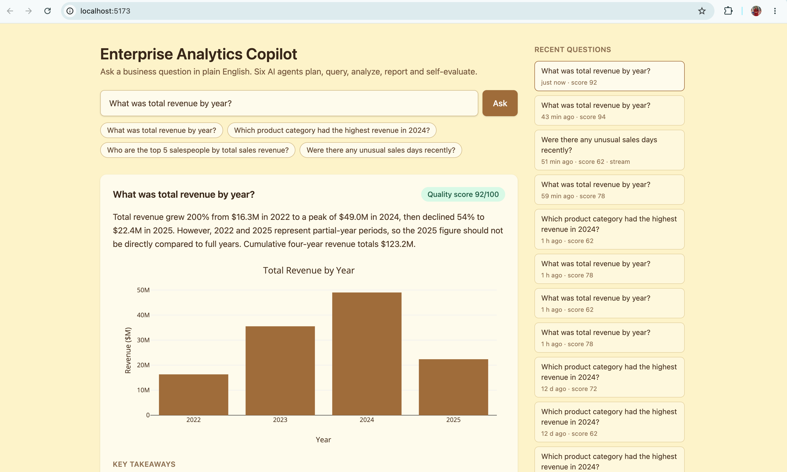
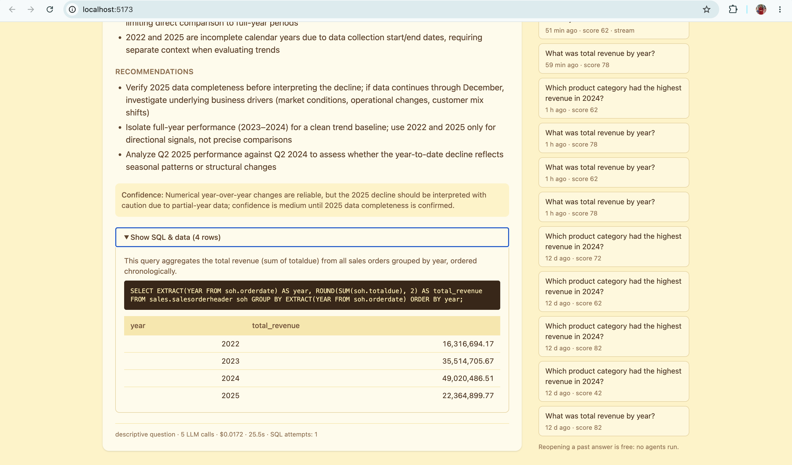
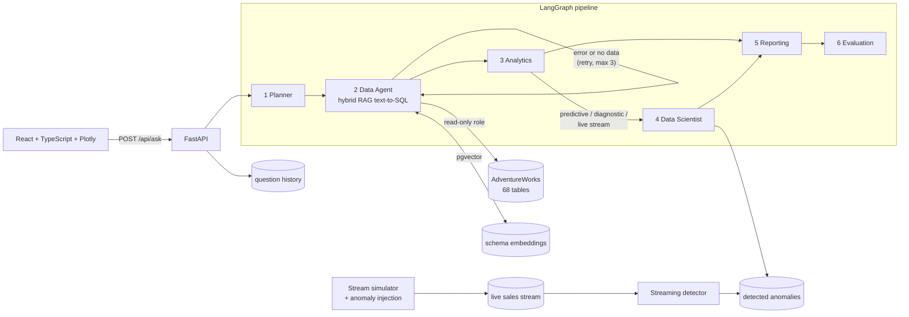

# Enterprise Analytics Copilot

**Ask a business question in plain English, and six AI agents plan the analysis, write and run SQL, analyze the results, run data-science models, write an executive report, and grade their own answer.**

A multi-agent system (LangGraph + Claude) over a 68-table PostgreSQL database, with hybrid RAG for schema retrieval, a simulated real-time sales stream with anomaly detection, a FastAPI backend and a React + TypeScript + Plotly frontend. Every component is evaluated with measured results.




## Key results

| What was measured | Result |
|---|---|
| **Text-to-SQL execution accuracy** (30 questions × 3 runs, strict / lenient) | **84.4% → 93.3%** / **85.6% → 100%** after adding hybrid schema RAG |
| Root cause of baseline errors (error analysis) | 12 of 14 were **schema-coverage gaps**; RAG targets exactly these |
| Schema retrieval recall (all needed tables in context) | Pure top-6: 22/30 · **Hybrid (curated + top-4): 30/30** |
| Self-correction loop | +0 points on the baseline, **+3.3 points with RAG** (fixes crashes, not plausible-but-wrong SQL) |
| Streaming anomaly detection (injected ground truth) | Recall rises from **7–12% (×2 anomalies) to 68–78% (×20)**; reliable above about ×10 |
| Report quality (Evaluation Agent, 0–100) | Same question: 62–78 → **94** after adding computed dataset facts |
| Cost | About **$0.015–0.03 per question** (Claude Haiku 4.5); the whole project was built for under **$1.20** of API usage |

## Architecture



| Agent | Role |
|---|---|
| **Planner** | Turns the question into a plan; classifies it (descriptive / diagnostic / predictive / comparative) and flags live-stream questions for routing |
| **Data Agent** | Retrieves the relevant tables (hybrid RAG), writes PostgreSQL, validates it (SELECT-only) and runs it on a read-only role; retries with error feedback |
| **Analytics** | pandas computes the statistics; the LLM interprets them |
| **Data Scientist** | Revenue forecasting (scikit-learn), anomaly detection, driver analysis, or the live stream's detector flags |
| **Reporting** | Executive summary, takeaways, recommendations, chart specifications and a confidence note |
| **Evaluation** | Critiques SQL correctness, groundedness and confidence calibration; scores 0–100 |

## Design decisions

- **Hybrid computation: Python computes, the LLM interprets.** Every number (aggregates, statistics, forecasts, anomaly scores) is computed deterministically in SQL or Python; the language model only explains it.
- **Hybrid RAG, chosen by measurement.** Pure retrieval missed "hub" tables like `salesorderheader` that questions rarely name (recall 22/30). Keeping a short curated context for the core sales tables and adding the top-4 retrieved tables from all 68 reached 30/30. Table descriptions are generated automatically from the database catalog (columns, comments, foreign keys).
- **Defense in depth.** SQL is validated as a single SELECT statement *and* executed on a PostgreSQL role that can only read.
- **Time-series data that keeps arriving.** A simulator replays the sales history day by day with a watermark, idempotent writes and reproducible labeled anomaly injection; a causal detector (rolling robust z-score on log revenue, no look-ahead) scans each batch as it lands.
- **Deterministic guardrails around LLM output.** Computed dataset facts (date coverage, partial years, reseller batch days), a top-N hint for `LIMIT` queries, score type normalization, and graceful failure: if the Evaluator fails, the user still gets the report.
- **Everything stored.** Every question, answer, score, cost and duration is saved as JSONB, so past answers can be reopened for free and debugged without re-running.

## Running it locally

**Prerequisites:** macOS or Linux, Docker, Conda (or Python 3.12), Node.js 20+, and an [Anthropic API key](https://console.anthropic.com/).

**1. Configure and start the database**
```bash
cp .env.example .env            # then edit .env with your own passwords and API key
docker compose --env-file .env -f docker/docker-compose.yml up -d
```

**2. Load AdventureWorks and create the read-only role** — follow [docs/data-setup.md](docs/data-setup.md).

**3. Create the application tables** (stream, detections, question history, pgvector)
```bash
docker exec -it analytics-copilot-postgres psql -U copilot_user -d analytics_copilot -c "CREATE EXTENSION IF NOT EXISTS vector;"
docker exec -i analytics-copilot-postgres psql -U copilot_user -d analytics_copilot < backend/ingestion/schema.sql
docker exec -i analytics-copilot-postgres psql -U copilot_user -d analytics_copilot < backend/api/schema.sql
```

**4. Python environment, schema index and live stream**
```bash
conda create -n analytics-copilot python=3.12 -y && conda activate analytics-copilot
pip install -r backend/requirements.txt
cd backend
python -m rag.store                                        # embed the 68 table descriptions (free, local model)
python -m ingestion.simulator --reset
python -m ingestion.simulator --days 30 --all --detect     # replay the stream with detection
```

**5. Run the backend** (from `backend/`)
```bash
uvicorn main:app --reload --port 8000                      # API docs at http://localhost:8000/docs
```

**6. Run the frontend** (in a second terminal)
```bash
cd frontend && npm install && npm run dev                  # open http://localhost:5173
```

## Evaluation

All experiments are reproducible from `backend/` (results are saved as JSON in `backend/benchmark/results/`).

| Experiment | Command | Cost |
|---|---|---|
| Text-to-SQL benchmark (with RAG) | `python -m benchmark.run --runs 3 --label rag` | ~$0.30 |
| Same benchmark without RAG | `SCHEMA_RAG=off python -m benchmark.run --runs 3 --label baseline` | ~$0.20 |
| Retrieval strategies (recall) | `python -m rag.compare_strategies` | free |
| Anomaly detection (precision/recall/F1) | `python -m ingestion.evaluate_detection` | free |
| Threshold sweep | `python -m ingestion.sweep_thresholds` | free |
| Anomaly-size sensitivity | `python -m ingestion.magnitude_experiment` | free |

**Benchmark design:** 30 business questions (easy / medium / hard) with hand-verified gold SQL, including trap questions (most recent month, a year with no data). Answers are compared by **result set**, not SQL text: column names, column order, extra columns and rounding are ignored, while row pairing is enforced. *Strict* requires every gold column; *lenient* allows differently formatted labels (e.g. first and last name in separate columns). The grader itself is unit-tested on hand-made cases.

**Anomaly-detection findings:** precision stays low (about 7–13%) because daily per-territory online revenue naturally swings 10× or more: a single bike versus a single accessory order. Error analysis traced the earliest false alarms to reseller batch days (67% of false spikes fell near month-end), which led to monitoring the online channel separately.

## Limitations

- **Small, self-written benchmark:** 30 questions (about 3.3 points each), written by the system's author, and RAG's `k` was chosen on the same questions. A held-out question set would give a fairer estimate.
- **Run-to-run variance:** the same question can produce different SQL and evaluation scores that differ by 10–20 points; results should be averaged over repeated runs.
- **LLM arithmetic:** the Reporting Agent occasionally derives an incorrect percentage despite instructions; the SQL & data panel lets users verify every number.
- **Latency:** six sequential agents take about 20–40 seconds per question.
- **Synthetic anomalies** on a sample dataset; the detection limits reflect this data's noise level.
- Single-user local deployment; no authentication.

## Project structure

~~~
backend/
  agents/       six agents, SQL executor, stream monitor, dataset facts
  graph/        LangGraph state, nodes and pipeline (routing, self-correction)
  rag/          schema descriptions, pgvector store, retrieval evaluation
  ingestion/    stream simulator, detector, detection experiments
  benchmark/    questions with gold SQL, grader, runner, saved results
  api/          FastAPI service and question-history table
  main.py       FastAPI app
frontend/       React + TypeScript + Tailwind + Plotly (Vite)
docker/         PostgreSQL 16 + pgvector
docs/           data setup and screenshots
~~~

## Tech stack

Python 3.12 · LangGraph · Anthropic Claude (Haiku 4.5) · FastAPI · SQLAlchemy · PostgreSQL 16 + pgvector · fastembed (bge-small) · pandas · scikit-learn · SciPy · React 19 · TypeScript · Vite · Tailwind CSS · Plotly · Docker

---

Built by **Soniya Apte** as an Advanced Machine Learning course project at North Dakota State University.
